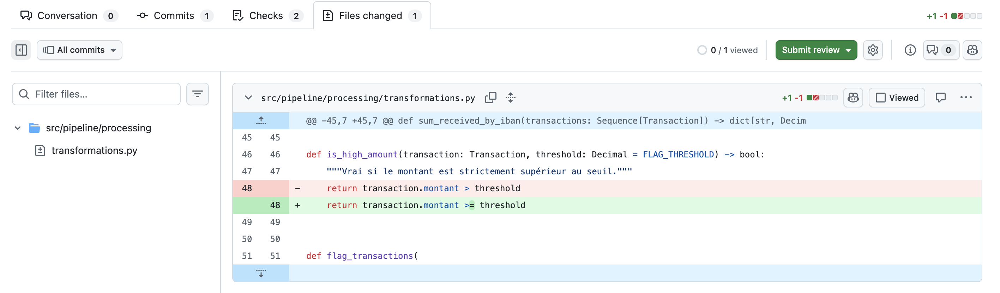
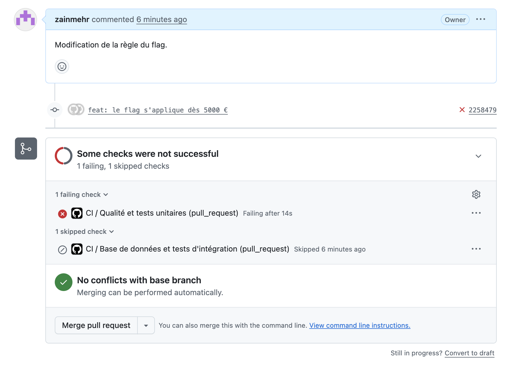
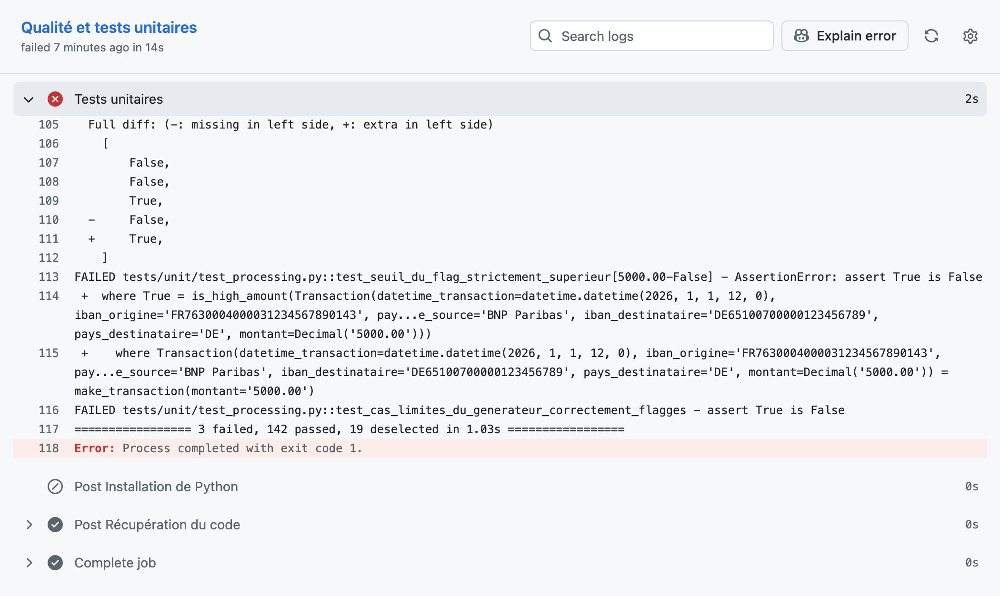
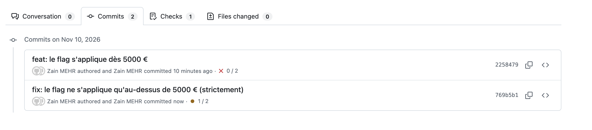
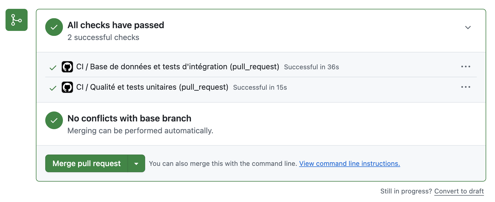

# Simulation d'un échec de pipeline (étape 1.6)

Ce document présente un échec volontaire de la pipeline CI, de sa cause à sa correction.

## Scénario

Un développeur modifie la règle du flag et remplace la comparaison « strictement
supérieur » par « supérieur ou égal ». Le sujet impose de flagger les transactions dont le
montant est **supérieur à 5000** : une transaction de 5000,00 € ne doit donc pas être
flaggée. Le changement passe inaperçu à la relecture, mais la CI le détecte.

## 1. La cause du problème

Dans `src/pipeline/processing/transformations.py` :

```diff
 def is_high_amount(transaction: Transaction, threshold: Decimal = FLAG_THRESHOLD) -> bool:
     """Vrai si le montant est strictement supérieur au seuil."""
-    return transaction.montant > threshold
+    return transaction.montant >= threshold
```



## 2. L'échec de la pipeline

La CI se déclenche à l'ouverture de la Pull Request. Le job « Qualité et tests unitaires »
échoue ; le job d'intégration, qui dépend du premier, n'est même pas lancé.



Conformément à la règle de l'équipe, une Pull Request n'est jamais fusionnée tant que la CI
n'est pas verte : le bug n'atteint pas la branche principale.

## 3. Le message d'erreur obtenu

Trois tests unitaires échouent, tous liés au cas limite de 5000,00 € :

```
FAILED tests/unit/test_processing.py::test_flags
FAILED tests/unit/test_processing.py::test_seuil_du_flag_strictement_superieur[5000.00-False]
FAILED tests/unit/test_processing.py::test_cas_limites_du_generateur_correctement_flagges
3 failed, 142 passed
```

Le détail de `test_flags` désigne précisément la transaction fautive :

```
E       assert [False, False, True, True] == [False, False, True, False]
E         At index 3 diff: True != False
```

La 4e transaction du jeu de test, d'un montant de 5000,00 €, est flaggée alors qu'elle ne
devrait pas l'être.



## 4. La correction apportée

La comparaison stricte est rétablie, conformément au sujet :

```diff
-    return transaction.montant >= threshold
+    return transaction.montant > threshold
```



## 5. La réussite de la pipeline après correction

Le push de la correction relance automatiquement la CI sur la même Pull Request. Les deux
jobs passent au vert et la Pull Request peut être fusionnée.



## Ce que montre ce scénario

- **Les cas limites sont testés.** Le jeu de données généré contient volontairement les
  montants 4999,99 €, 5000,00 € et 5000,01 € : un écart d'un centime suffit à faire échouer
  les tests.
- **Les résultats attendus sont fixés à la main.** Les tests comparent à des valeurs écrites
  en dur, et non recalculées par le code testé : un bug dans le code ne peut pas se
  « tester lui-même ».
- **La CI échoue vite.** Le job d'intégration n'est pas lancé si les tests unitaires
  échouent, ce qui donne un retour en moins d'une minute.
- **La CI est un garde-fou.** Le bug est détecté avant d'atteindre `main`, sans
  intervention humaine.
